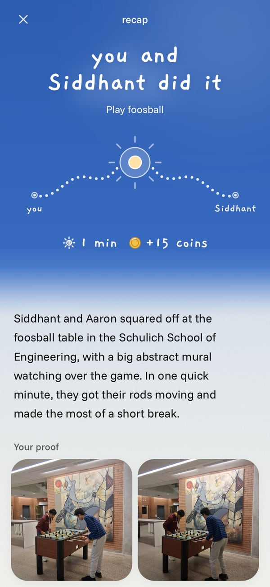
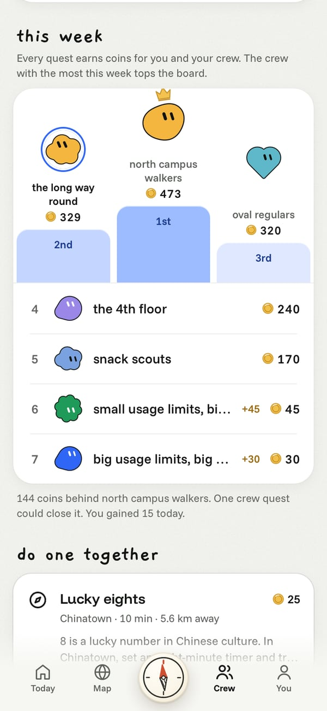
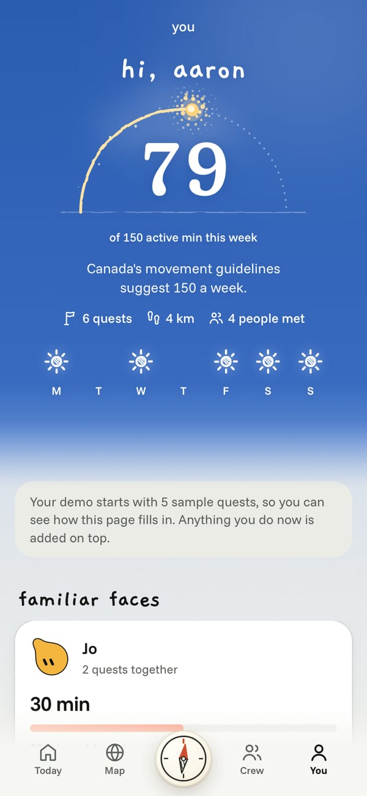
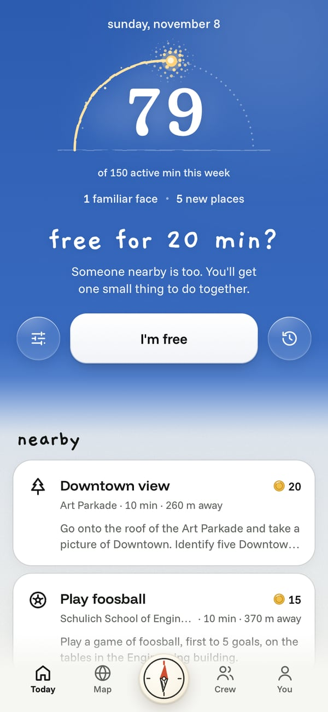
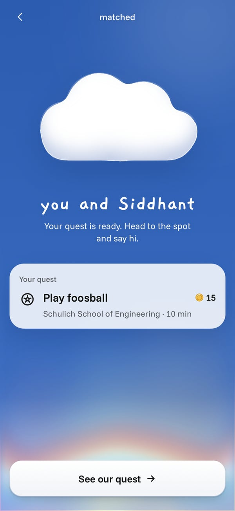
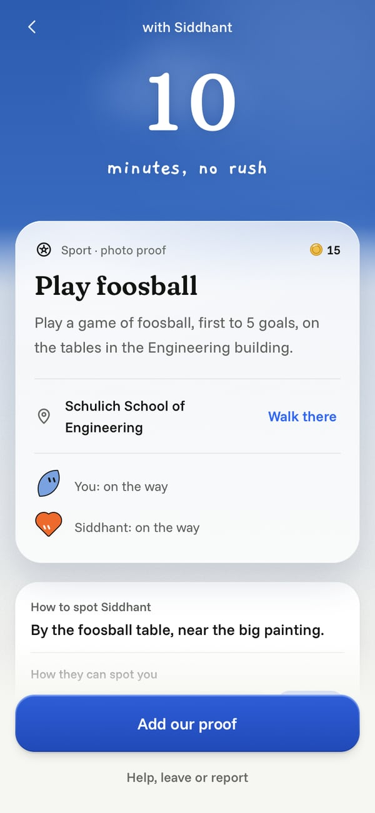
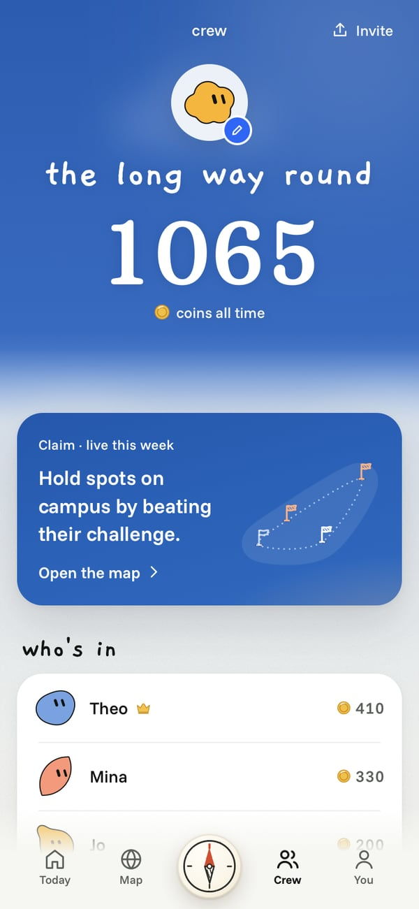
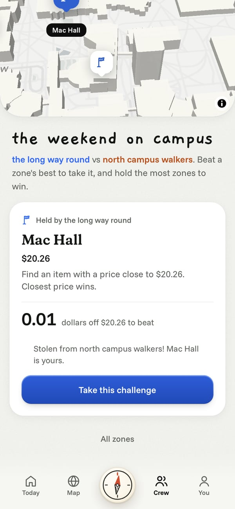
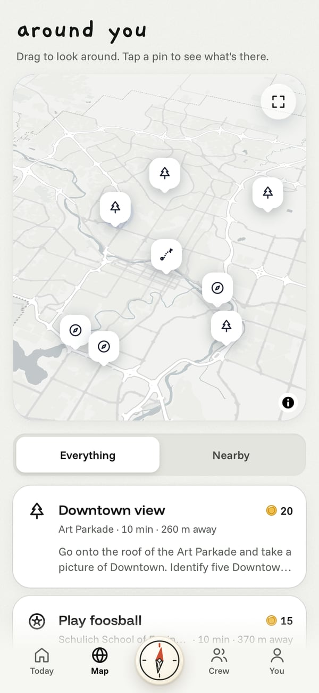

  

<h1 align="center">Amble</h1>

Twenty minutes, someone new, somewhere outside.

  <a href="https://amble.health">amble.health</a> ·
  <a href="https://devpost.com/software/9dszkw-small-usage-limits-big-dreams-amble">Devpost</a> ·
  Built in 24 hours at Hack the Change 2026, Calgary

  
  

Amble gives strangers short, fun challenges to do together outside. When you have some time, you tap "I'm free", get paired with someone nearby, and meet them at a public spot to do the challenge. We wrote all of them by hand for places Calgarians know, like the +15, Chinatown, Nose Hill and the Calgary Tower. One of ours, at the Foothills Athletic Park: "Film each other running 100 m backwards on the track, then play the videos in reverse to see whose run looks more normal."

You can also start a crew with your friends and compete with other crews to claim spots around campus.

## Try it

Open [amble.health](https://amble.health) on two phones and tap Try the demo on each. You don't need an account. Tap "I'm free" on both and you'll get matched. On your own, Amble tells you nobody's free yet and gives you a link to send to someone. In Chrome on Android you can also install it like an app.

## Why we built it

23% of Canadians aged 15 to 24 always or often feel lonely, the highest of any age group ([Statistics Canada](https://www.statcan.gc.ca/o1/en/plus/274-you-are-not-alone)). In Calgary it's 26% of 18 to 34 year olds ([City of Calgary, 2025](https://www.calgary.ca/content/dam/www/programs-services/social-programs-and-services/mental-health-and-addiction-strategy/mental-health-calgarians-final-report-2025.pdf)). And only 46% of Canadian adults get the recommended 150 active minutes a week ([Statistics Canada](https://www150.statcan.gc.ca/n1/daily-quotidien/261021/dq261021-eng.htm)). We wanted one app that goes after both problems.

Making a friend usually means planning a coffee and making small talk, which is the hard part for newcomers, people living alone and anyone shy. A shared challenge gives you something to do instead.

We were inspired by AR games like Pokemon Go, and the challenges especially by the game show Jet Lag: The Game, which is full of collaborative challenges tied to real places.

## How a quest works

Tap "I'm free" and Amble looks for someone nearby. You both get the same quest at a public place and meet there, never at each other's location, and your location is deleted the moment you're matched. You only see each other's first name once you both say yes, and during the quest, one tap opens 911 and Campus Security or lets you leave. If nobody's around, you can send the quest to someone you're with by link or AirDrop.

Amble picks quests that suit you both: step-free places first, shorter quests if you want an easier pace, and side-by-side quests if you'd rather not chat.

When you've done it, you send a photo or short video and an AI model checks it against the quest. If it passes, you get coins. Then you see a short recap of what you did, and you can choose to stay in touch.

  
  
  

Same foosball quest, two real photos. Ping pong doesn't count.

## Crews and Claim

Crews share quests and earn coins together, and the coins go toward a weekly board. Claim is a second game where two crews compete for spots around campus. Each spot has a challenge, for example "Hold a plank for as long as possible and record it. Longer plank wins." If nobody holds a spot, finishing the challenge takes it. If another crew holds it, you have to beat their score to steal it.

The You tab keeps your own numbers, never ranked against anyone: active minutes against Canada's 150-minute guideline, familiar faces (people you've done several quests with), new places, and how you felt before and after each quest. The whole app is built for screen readers and respects Reduce Motion.

  
  
  

More screenshots

 

  
  
  

  
  
  

## How we built it

It's one Next.js app on Vercel. Auth0 handles sign-in, and Postgres on Tiger Data stores everything, with location pings in a TimescaleDB hypertable. We wrote every quest by hand, at real places around UCalgary and Calgary. Claude Haiku checks the proof and writes the recaps, and if it's slow or down, your quest still counts. We used Claude Code as a coding assistant.

There are no background workers: the game moves forward whenever a phone checks in, and the server enforces every rule.

Built with Next.js, React, TypeScript, Tailwind CSS, Motion, bun, Postgres, Tiger Data (TimescaleDB), Auth0, Claude Haiku, MapLibre, OpenStreetMap and Vercel.

To run it yourself, see [DEVELOPMENT](docs/DEVELOPMENT.md).

## What's next

All our challenges so far were written by us, so we want to support user-generated challenges for Quests and Claim. We also want to expand beyond Calgary and add new game modes.

## Team

- **Danny Wang** ([@ThePeeps191](https://github.com/ThePeeps191))
- **Siddhant Arora** ([@siddhantarora7](https://github.com/siddhantarora7))
- **Aaron He** ([@mucube](https://github.com/mucube))
- **Jonas Huang** ([@wawahwa801](https://github.com/wawahwa801))
