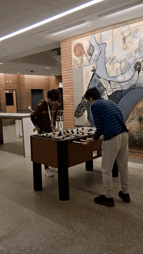
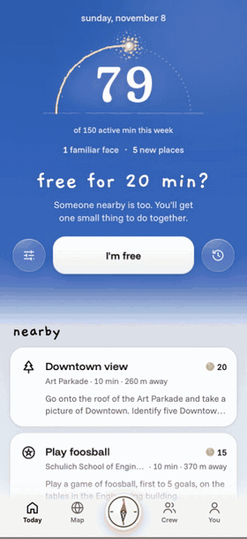
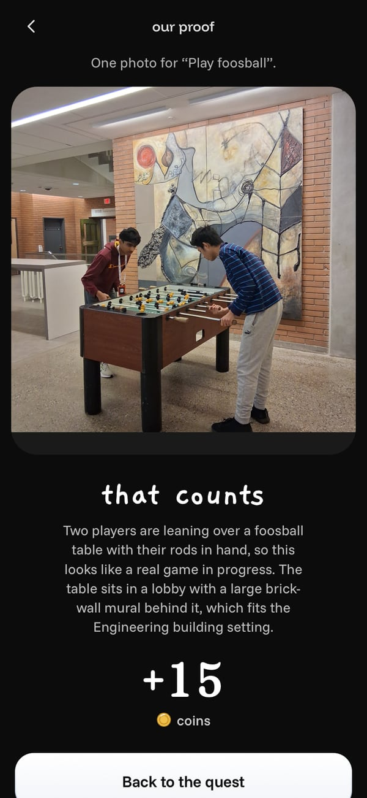
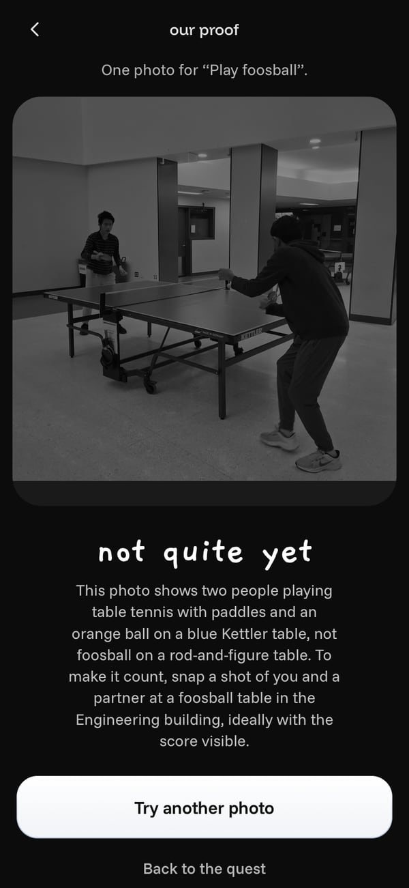
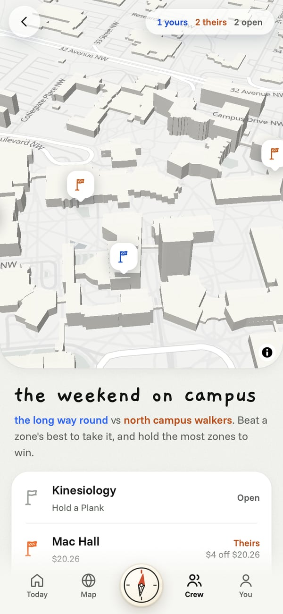
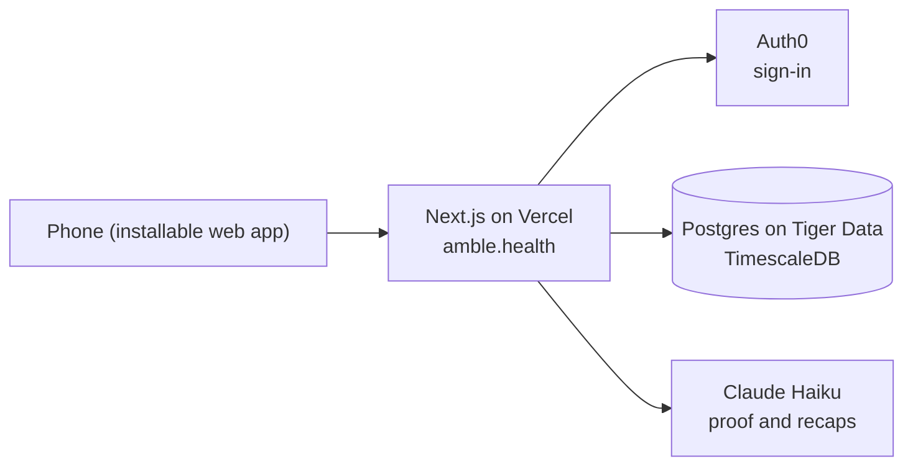

  

<h1 align="center">Amble</h1>

Twenty minutes, someone new, somewhere outside.

  <a href="https://amble.health">amble.health</a> ·
  <a href="https://devpost.com/software/9dszkw-small-usage-limits-big-dreams-amble">Devpost</a> ·
  Built in 24 hours at Hack the Change 2026, Calgary

  
  

Amble gives strangers short, fun challenges to do together outside. When you have some time, you tap "I'm free", get paired with someone nearby, and meet them at a public spot to do the challenge. One of ours, at the Foothills Athletic Park: "Film each other running 100 m backwards on the track, then play the videos in reverse to see whose run looks more normal."

You can also start a crew with your friends and compete with other crews to claim spots around campus.

## Try it

Open [amble.health](https://amble.health) on your phone and tap Try the demo. You don't need an account. If nobody else is free, a practice partner called Priya plays along, so you can go through the whole thing by yourself. In Chrome on Android you can also install it like an app.

## Why we built it

23% of Canadians aged 15 to 24 always or often feel lonely, the highest of any age group ([Statistics Canada](https://www.statcan.gc.ca/o1/en/plus/274-you-are-not-alone)). In Calgary it's 26% of 18 to 34 year olds ([City of Calgary, 2025](https://www.calgary.ca/content/dam/www/programs-services/social-programs-and-services/mental-health-and-addiction-strategy/mental-health-calgarians-final-report-2025.pdf)). And only 46% of Canadian adults get the recommended 150 active minutes a week ([Statistics Canada](https://www150.statcan.gc.ca/n1/daily-quotidien/261021/dq261021-eng.htm)). We wanted one app that goes after both problems.

We were inspired by AR games like Pokemon Go, and the challenges especially by the game show Jet Lag: The Game, which is full of collaborative challenges tied to real places.

We built it for Prompt 1 of Hack the Change, under community connection and inclusion, and proactive health and wellness.

## How a quest works

Tap "I'm free" and Amble looks for someone nearby. All you see at first is a rough distance, then a first name once you both say yes. You both get the same quest at a public place and meet there, never at each other's location. Each of you can add one line so the other can spot you, like "red jacket, by the main doors". If nobody's around, Amble tells you, and you can send the quest to someone you're with by link or AirDrop.

When you've done it, you send a photo or short video and Claude Haiku checks it against the quest. If it passes, you get coins. Then you see a short recap of the quest, how long you were active and how you felt before and after, which only you can see. You can choose to stay in touch, and you only connect if you both say yes.

  
  
  

The same foosball quest with two real photos. We sent the ping pong one on purpose.

**With friends**

- **Crews** share quests, earn coins together and race on a weekly board. Pick a character for yourself on the You tab, and one for your crew on the Crew tab.
- **Claim** turns campus into a board of zones. Beat a zone's challenge to take it for your crew, and steal zones from rival crews.

**The You tab**

Private numbers that matter, never ranked against anyone: active minutes against Canada's 150-minute guideline, familiar faces (people you've done several quests with), new places you've been, and how you felt before and after each quest.

## Inclusive and safe by design

- **Comfort settings:** step-free places first, a short and easy pace, and side-by-side quests for people who'd rather not chat face to face.
- **Public places only.** You meet at the quest spot, never at someone's location.
- **Little personal data.** Your location is deleted the moment you're matched. You can download or delete everything from the privacy page, which also says which AI sees your photos.
- **Built-in meeting rules.** For real accounts, meeting someone new needs a verified email and happens in daylight (8 AM to 5 PM), and proof must be taken near the spot during the quest. The judging site runs in demo mode, which switches these off so anyone can try Amble from a desk at any hour.
- **Help one tap away.** During a quest, "Help, leave or report" shows 911 and UCalgary Campus Security, lets you leave without blaming anyone, or report. If you report someone, you're never paired with them again.
- **Pick the quest, then the person.** Open any quest and tap "Find someone to do it with": whoever you're matched with does that one.
- **Honest when it's quiet.** If nobody's free nearby after 45 seconds, Amble says so and offers a link to send to someone you're with.

## How it works

- **One Next.js app** serves the screens and a small API. Every rule (matching, quest runs, coins, Claim) runs on the server, inside database transactions, so two phones can't race each other into a bad state.
- **No background workers.** Phones check in every few seconds, and each check-in moves the state forward: a match expires, a quest ends, a bot partner answers. Nothing has to run on a timer.
- **Postgres on Tiger Data** stores everything. Location pings live in a TimescaleDB hypertable with a 30-day retention policy, so routes delete themselves, and the You tab's week is built with TimescaleDB's `time_bucket`. Proof photos are stored in the database too.
- **Auth0** handles sign-in. Judges get a signed demo login, so they never need an account.
- **Works on a bad day.** GPS denied, no signal, or the AI slow: each has a friendly fallback, and every AI call has a timeout.

### Where the AI fits

We kept the AI in a narrow job it can do reliably:

- **It checks proof.** Claude Haiku looks at the photo, or three still frames from a video, and decides whether it shows the quest, with a one-line reason written to the player.
- **It writes the recap.** Two warm sentences about your walk, built only from what happened and what the photo shows.
- **It doesn't write the quests.** We wrote every quest by hand, at real public places around UCalgary and Calgary, so each one is safe and worth doing.

It's told to be generous with honest attempts: indoor shots, one photo for a quest with several parts, and a photo of a screen when the quest is about one all count. If the AI is down, the quest still counts. Nobody should lose a real walk to our outage. And if it gets one wrong during the demo, "Try the demo" guests can tap **Count it anyway**.

## Built with

| | |
| --- | --- |
| App | Next.js 16, React 19, TypeScript, Tailwind CSS 4, Motion, bun |
| Data | Postgres on Tiger Data (TimescaleDB), embedded Postgres (PGlite) for local development |
| Sign-in | Auth0 |
| AI | Claude Haiku (Anthropic) |
| Maps | MapLibre GL, OpenStreetMap |
| Hosting | Vercel, at amble.health |

## How we built it

Four of us built Amble in 24 hours with Claude Code as our coding assistant, running many sessions in parallel. Each session worked in its own git worktree and branch, opened a small pull request, and merged it once it worked, so dozens of changes landed every hour without stepping on each other. The rules every session followed are in [CLAUDE.md](CLAUDE.md).

We made the product decisions: the idea and focus areas, the safety rules, the metrics and the research behind them, the quests, the design and what to cut. An end-to-end test (`scripts/smoke.ts`) drives the whole product over HTTP as a dozen simulated people.

## Repository

| Path | What's there |
| --- | --- |
| `src/app/` | Screens and API routes |
| `src/features/` | One folder per feature: matching, quests, proof, recap, crews, Claim, the You tab |
| `src/server/` | The rules: matching, runs, proof, crews, Claim, coins |
| `src/lib/` | Shared types, the API client, and the seams for sign-in, AI and the database |
| `data/quests/` | The hand-written quests |
| `db/migrations/` | The database schema |
| `docs/` | How it works ([TECHNICAL](docs/TECHNICAL.md) for a short summary, [WALKTHROUGH](docs/WALKTHROUGH.md), [ARCHITECTURE](docs/ARCHITECTURE.md)) and how we work ([DEVELOPMENT](docs/DEVELOPMENT.md)) |

## Team

- **Danny Wang** ([@ThePeeps191](https://github.com/ThePeeps191))
- **Siddhant Arora** ([@siddhantarora7](https://github.com/siddhantarora7))
- **Aaron He** ([@mucube](https://github.com/mucube))
- **Jonas Huang** ([@wawahwa801](https://github.com/wawahwa801))
