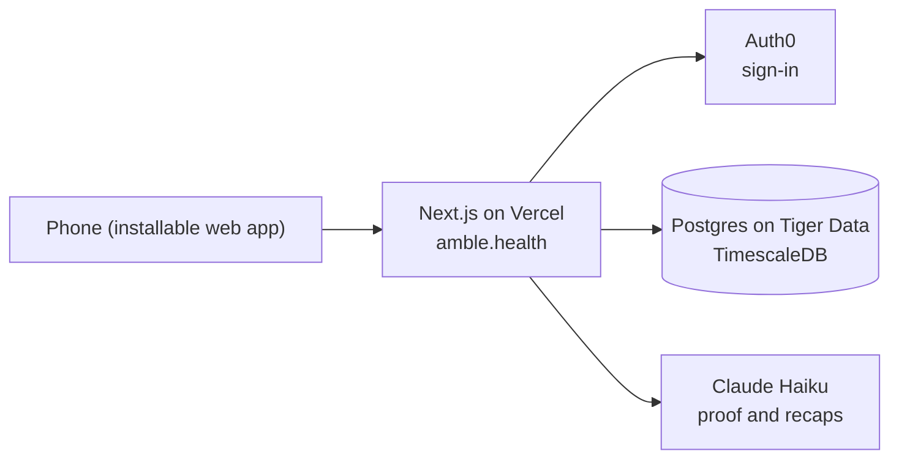

  

<h1 align="center">Amble</h1>

<strong>Twenty minutes, someone new, somewhere outside.</strong>

  <a href="https://amble.health">Try it at amble.health</a> ·
  <a href="https://devpost.com/software/9dszkw-small-usage-limits-big-dreams-amble">Devpost</a> ·
  Built in 24 hours at Hack the Change 2026, Calgary

---

Amble gets people outside together. Tap **"I'm free"**, and Amble pairs you with someone nearby who's free too. You both get the same small 20-minute quest at a real, public place: a game of ping-pong to 13 in the engineering building, say. There's something to do besides small talk, and a natural ending. Snap a photo, an AI checks it, and you get a recap of your walk. If you both want to, you stay in touch.

With friends, you form a **crew**, take on quests together, earn coins and play **Claim**, a game that turns campus into a map of spots to take and steal.

## Try it

Open **[amble.health](https://amble.health)** on your phone and tap **Try the demo**. You don't need an account, a partner or GPS: a practice partner, Priya, matches with you and plays along. In Chrome on Android you can also install it like an app (⋮ → Install app).

## Why

- **23%** of Canadians aged 15 to 24 always or often feel lonely, the highest of any age group ([Statistics Canada](https://www.statcan.gc.ca/o1/en/plus/274-you-are-not-alone)).
- Only **46%** of Canadian adults get the recommended 150 active minutes a week ([Statistics Canada](https://www150.statcan.gc.ca/n1/daily-quotidien/261021/dq261021-eng.htm)).

Making a friend usually means planning a coffee and making small talk, which is exactly the hard part for newcomers, people living alone and anyone shy. Amble swaps the small talk for a shared task, and the coffee for a walk.

We built it for Hack the Change's Prompt 1, through two focus areas: **community connection and inclusion**, and **proactive health and wellness**.

## What it does

**Meet someone new (20 minutes)**

1. **I'm free.** Tell Amble you have twenty minutes.
2. **Matched.** Someone nearby is free too. You see only a rough distance until you both say yes, then just a first name.
3. **The quest.** You both get the same small task at a public spot. You meet there, never at each other's location.
4. **Proof.** One photo or short video. An AI referee checks it against the quest.
5. **Recap.** A short story of your walk, the minutes you were active, and the choice to stay in touch. You only connect if you both say yes.

**With friends**

- **Crews** share quests, earn coins together and race on a weekly board.
- **Claim** turns campus into a board of zones. Beat a zone's challenge to take it for your crew, and steal zones from rival crews.

**The You tab**

Private numbers that matter, never ranked against anyone: active minutes against Canada's 150-minute guideline, familiar faces (people you've done several quests with), new places you've been, and how you felt before and after each quest.

## Inclusive and safe by design

- **Comfort settings:** step-free places only, a short and easy pace, and side-by-side quests for people who'd rather not chat face to face.
- **Public places only.** You meet at the quest spot, never at someone's location.
- **Little personal data.** Your location is deleted the moment you're matched. You can download or delete everything from the privacy page, which also says which AI sees your photos.
- **One tap to report.** If you report someone, you're never paired with them again.

## How it works

- **One Next.js app** serves the screens and a small API. Every rule (matching, quest runs, coins, Claim) runs on the server, inside database transactions, so two phones can't race each other into a bad state.
- **No background workers.** Phones check in every few seconds, and each check-in moves the state forward: a match expires, a quest ends, a bot partner answers. Nothing has to run on a timer.
- **Postgres on Tiger Data** stores everything. Location pings live in a TimescaleDB hypertable with a 30-day retention policy, so routes delete themselves. Proof photos are stored in the database too.
- **Auth0** handles sign-in. Judges get a signed demo login, so they never need an account.
- **Works on a bad day.** GPS denied, no signal, or the AI slow: each has a friendly fallback, and every AI call has a timeout.

### Where the AI fits

We kept the AI in a narrow job it can do reliably:

- **It checks proof.** Claude Haiku looks at the photo, or three still frames from a video, and decides whether it shows the quest, with a one-line reason written to the player.
- **It writes the recap.** Two warm sentences about your walk, built only from what happened and what the photo shows.
- **It doesn't write the quests.** We wrote every quest by hand, at real public places around UCalgary and Calgary, so each one is safe and worth doing.

If the AI is down, the quest still counts. Nobody should lose a real walk to our outage.

## Built with

| | |
| --- | --- |
| App | Next.js 16, React 19, TypeScript, Tailwind CSS 4, Motion, bun |
| Data | Postgres on Tiger Data (TimescaleDB), embedded Postgres (PGlite) for local development |
| Sign-in | Auth0 |
| AI | Claude Haiku (Anthropic) |
| Maps | MapLibre GL, OpenStreetMap |
| Hosting | Vercel, at amble.health |

## How we built it

Four of us built Amble in 24 hours with Claude Code as our coding assistant, running many sessions in parallel. Each session worked in its own git worktree and branch, opened a small pull request, and merged it once it worked, so dozens of changes landed every hour without stepping on each other. The rules every session followed are in [CLAUDE.md](CLAUDE.md).

We made the product decisions: the idea and focus areas, the safety rules, the metrics and the research behind them, the quests, the design and what to cut. An end-to-end test (`scripts/smoke.ts`) drives the whole product over HTTP as a dozen simulated people.

## Repository

| Path | What's there |
| --- | --- |
| `src/app/` | Screens and API routes |
| `src/features/` | One folder per feature: matching, quests, proof, recap, crews, Claim, the You tab |
| `src/server/` | The rules: matching, runs, proof, crews, Claim, coins |
| `src/lib/` | Shared types, the API client, and the seams for sign-in, AI and the database |
| `data/quests/` | The hand-written quests |
| `db/migrations/` | The database schema |
| `docs/` | How it works ([WALKTHROUGH](docs/WALKTHROUGH.md), [ARCHITECTURE](docs/ARCHITECTURE.md)) and how we work ([DEVELOPMENT](docs/DEVELOPMENT.md)) |

## Team

- **Danny Wang** ([@ThePeeps191](https://github.com/ThePeeps191))
- **Siddhant Arora** ([@siddhantarora7](https://github.com/siddhantarora7))
- **Aaron He** ([@mucube](https://github.com/mucube))
- **Jonas Huang** ([@wawahwa801](https://github.com/wawahwa801))
